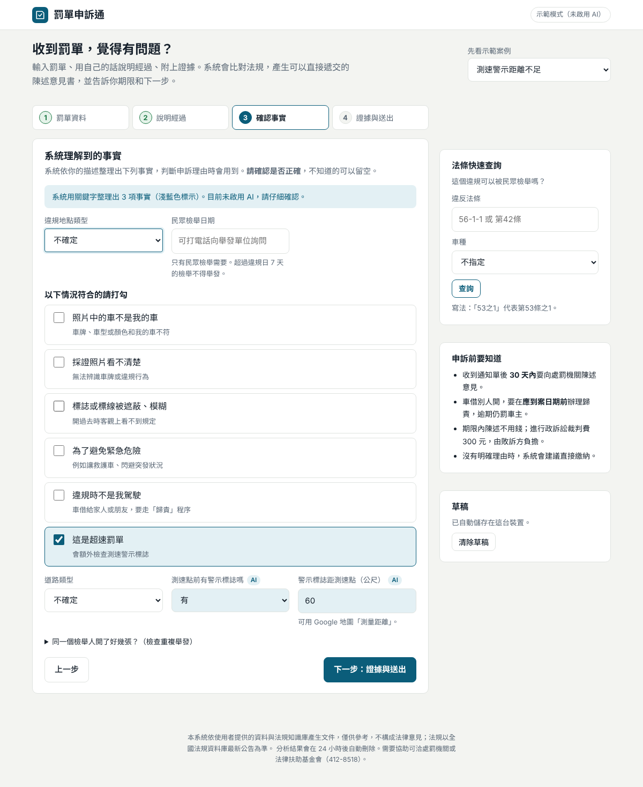
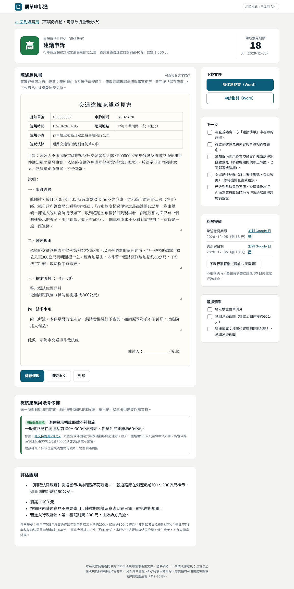

# 罰單申訴通：交通違規申訴文件 AI 生成助手

> 2026 NextWave AI法創黑客松 原型專案

把**罰單**、**你的說法**和**證據**交給系統，系統會比對法規、找出可以主張的申訴理由，並產生可以直接遞交的**陳述意見書**、**申訴指引**（證據清單、期限、下一步）。附加功能是**申訴可行性評估**：給出「高／中／低」與理由，而不是一個看起來很準、其實無法驗證的百分比。





## 使用者端功能

- **四步驟填寫**：罰單資料 → 說明經過 → 確認事實 → 證據與送出，手機也好操作。
- **拍照辨識罰單**（AI 模式）：自動填入欄位，AI 填的欄位以淺藍底標示，提醒使用者核對。
- **白話說明＋快捷句＋語音輸入**：點常見情況就能加入句子，Chrome 可用語音輸入。
- **事實確認**：系統把說明整理成事實，讓使用者逐項確認後才判斷，避免 AI 誤解。
- **法條快速查詢**：輸入法條，馬上知道能不能被民眾檢舉。
- **線上修改陳述意見書**：直接在網頁上改，下載的 Word 檔同步更新；可複製全文貼到線上陳述表單、可列印。
- **歸責實際駕駛人申請書**：車借別人開時自動產生。
- **期限提醒**：倒數天數、一鍵加到 Google 日曆或下載行事曆檔（提前 3 天提醒）。
- **待辦與證據清單可勾選**、**填寫草稿自動保存**在使用者自己的瀏覽器。
- **隱私**：證據檔不上傳、照片不存檔、結果 24 小時後自動刪除。

---

## 快速開始（5 分鐘）

```bash
# 1. 安裝（Python 3.10 以上；Mac 建議先建立虛擬環境）
python3 -m venv .venv && source .venv/bin/activate
pip install -r requirements.txt

# 2. 命令列跑一個示範案例
python cli.py samples/01_機車騎樓_民眾檢舉.json
#   → output/01_機車騎樓_民眾檢舉/陳述意見書.docx、申訴指引.docx

# 3. 開網頁版
python web/app.py
#   → 打開 http://127.0.0.1:5000 ，點上方「示範案例」即可帶入資料

# 4. 跑測試
python -m pytest -q
```

預設是**離線示範模式**，不需要任何 API 金鑰就能完整 Demo：罰單欄位手動輸入，陳述內容用關鍵字整理。

### 部署到伺服器

已附 Dockerfile、docker-compose（含 Caddy 自動 HTTPS）、gunicorn 設定與健康檢查 `/healthz`。步驟見 **[docs/部署指南.md](docs/部署指南.md)**：

```bash
cp .env.example .env      # 填網域與 AI 設定
docker compose up -d --build
```

### 開啟 AI 模式

| 模式 | 設定 | 用途 |
|---|---|---|
| 離線（預設） | `LLM_PROVIDER=none` | Demo、測試，不呼叫 AI |
| AWS Bedrock | `pip install boto3`，設定 AWS 憑證，`LLM_PROVIDER=bedrock`、`BEDROCK_MODEL_ID=...` | 與 PartyRock 同一套模型服務 |
| Anthropic | `pip install anthropic`，`ANTHROPIC_API_KEY=...`，`LLM_PROVIDER=anthropic` | 另一個選擇 |
| Gemini（免費） | `pip install google-genai`，`GEMINI_API_KEY=...`，`LLM_PROVIDER=gemini` | 有免費額度，適合開發測試 |

安裝 `pip install -r requirements-ai.txt`。開啟後會多出三個能力：**辨識罰單照片**、**理解白話陳述**、**把事實經過改寫成公文語氣**。範例設定見 `.env.example`。

---

## 系統怎麼運作

```
 罰單照片／欄位 ──┐
 使用者的說法 ────┼─▶ ① AI 理解（擷取欄位、整理事實）
 證據 ───────────┘            │  只做「讀」與「整理」，不判斷法律
                              ▼
                   ② 規則引擎（確定性程式）
                     逐條比對法規要件，每個結論附法條
                              │
              ┌───────────────┼────────────────┐
              ▼               ▼                ▼
      ③ 陳述意見書      ④ 申訴指引        ⑤ 可行性評估
   （法律理由由規則產生， （期限、下一步、   （高／中／低＋理由，
     AI 只改寫事實經過）   證據清單）         附公開統計基準）
              │
              ▼
       ⑥ 防幻覺檢查：AI 文字若引用未經確認的法條、
          或出現原始資料沒有的數字 → 自動退回範本
```

**核心設計：AI 負責理解，規則負責判斷。** 法律理由一律由 `appeal/rules.py` 產生、法條摘要一律來自 `appeal/knowledge/` 知識庫，AI 不會自己寫出任何法條。這讓每個結論都能追溯、也能被測試。

### 目前的檢核規則

| 編號 | 規則 | 強度 | 法令依據 |
|---|---|---|---|
| R01 | 民眾檢舉的項目不在可檢舉清單內（含機車、騎樓等例外） | 明確瑕疵 | 道交條例第7條之1第1項 |
| R02 | 檢舉日距違規日超過 7 日 | 明確瑕疵 | 道交條例第7條之1第2項 |
| R03 | 同車同規定 6 分鐘內、未經過路口而被重複舉發 | 明確瑕疵 | 道交條例第7條之1第3項 |
| R04 | 測速警示標誌未設置或距離不符（一般道路 100–300m／高快速 300–1000m） | 明確瑕疵 | 道交條例第7條之2 |
| R05 | 採證照片車牌、車種與本人車輛不符 | 明確瑕疵 | 行政程序法第36條、行政罰法第7條 |
| R06 | 採證影像模糊，無法辨識車牌或違規事實 | 可主張 | 行政程序法第36條 |
| R07 | 標誌標線遭遮蔽或不清 | 可主張 | 道交條例第4條、行政罰法第7條 |
| R08 | 為避免緊急危難（讓救護車、閃避危險） | 可主張 | 行政罰法第13條 |
| R09 | 違規時不是本人駕駛 → 改走「歸責他人」程序 | 程序 | 道交條例第85條 |

資訊不足時，規則會回傳「待補充資訊」，提示使用者要補什麼，而不是自己假設。

### 示範案例（`samples/`；01–06 為虛構，07 為公開的真實罰單、個資已遮蔽）

| 案例 | 預期結果 |
|---|---|
| 01 機車停騎樓被民眾檢舉 | 高：機車不在可檢舉範圍＋檢舉逾 7 日 |
| 02 測速警示標誌只有 60 公尺 | 高：警示距離不符 |
| 03 禁止左轉標誌被樹擋住 | 中：可主張，需補照片 |
| 04 闖紅燈、照片清楚 | 低：建議繳納，不產生陳述意見書 |
| 05 機車借同學騎 | 程序：在應到案日期前辦理歸責 |
| 06 同一檢舉人 4 分鐘內拍兩次方向燈 | 高：重複舉發 |
| 07 真實罰單：航警局測速單（101 年） | 低＋待補充：提醒確認測速警示標誌；應到案日期已過 |

---

## 專案結構

```
ticket-appeal-ai/
├── appeal/                    核心套件
│   ├── models.py              資料結構（罰單、事實、檢核結果…）
│   ├── parsing.py             法條與民國日期解析（支援國字數字）
│   ├── knowledge/             法規知識庫（可檢舉項目、法條摘要、統計基準）
│   ├── knowledge_base.py      知識庫查詢
│   ├── rules.py               規則引擎（R01–R09）
│   ├── assessment.py          可行性評估、期限計算、下一步
│   ├── llm.py                 AI 介接（Bedrock／Anthropic／離線）
│   ├── prompts/               提示詞（PartyRock 版也用同一套）
│   ├── ai_steps.py            讀罰單、整理陳述、改寫事實＋防幻覺檢查
│   ├── pipeline.py            主流程
│   └── documents.py           產生 Word 文件
├── web/                       Flask 網頁版（app.py、templates/、static/）
├── wsgi.py                    正式部署進入點
├── Dockerfile、docker-compose.yml、deploy/   部署設定（gunicorn、Caddy）
├── cli.py                     命令列版
├── samples/                   7 個示範案例（含 1 張真實罰單）
├── tests/                     40 個自動測試（規則、防幻覺、網頁 API）
└── docs/
    ├── 部署指南.md             本機、雲端主機、AWS App Runner、Render
    ├── PartyRock_建置指南.md   用低程式平台重現原型
    └── Demo腳本.md             決賽 3 分鐘展示流程
```

## 擴充方式

- **新增一條規則**：在 `appeal/rules.py` 寫一個加上 `@rule` 的函式，回傳 `Finding`；法條摘要加到 `knowledge/laws.json`；在 `tests/` 補一個案例。
- **更新法規**：修改 `knowledge/reportable_items.json` 或 `laws.json`，並更新 `as_of` 日期。
- **加入判決檢索（未來）**：把司法院裁判書開放資料中的交通裁決事件建成檢索庫，在評估時顯示相似案例。

## 限制與聲明

- 本系統產出僅供參考，**不構成法律意見**；是否遞交由使用者自行決定。
- 法規摘要整理日期為 2026-11-17，正式條文以[全國法規資料庫](https://law.moj.gov.tw/)最新公告為準。第7條之1可檢舉項目依桃園市政府交通事件裁決處、雲林縣警察局公開頁面整理。
- 可行性評估依「是否符合法規要件」分級，參考基準來自臺中市交通事件裁決處、臺北市科技執法申訴的公開統計，不是個案勝訴率預測。
- 系統不協助捏造證據；證據檔不上傳、罰單照片不存檔，分析結果預設 24 小時後自動刪除。
